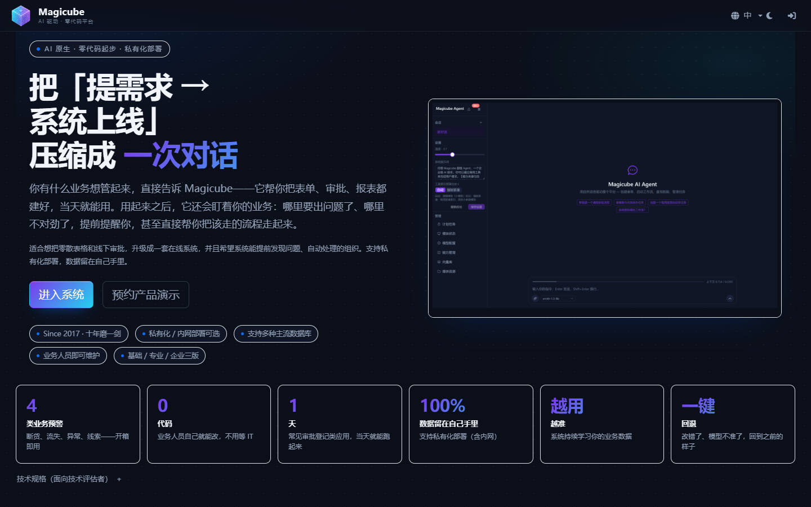
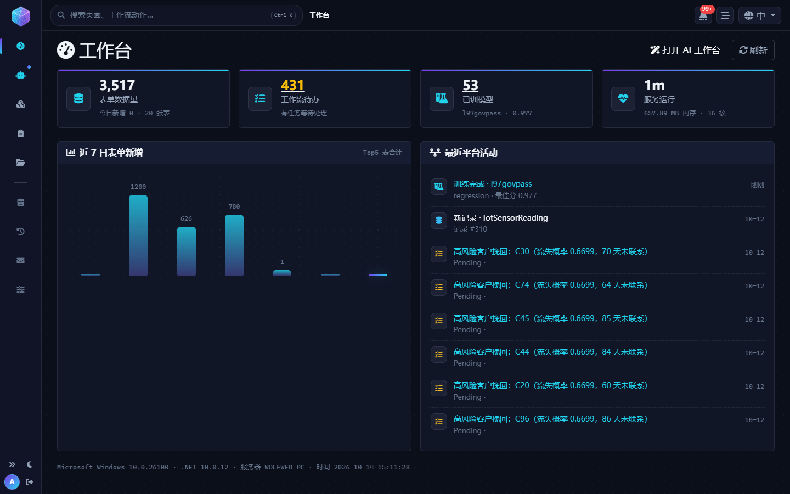
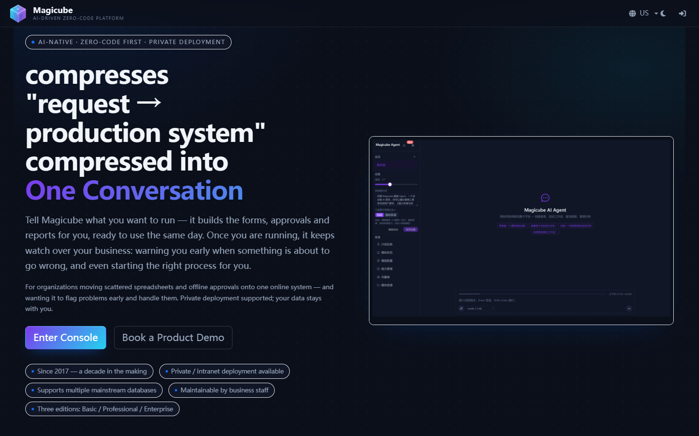

# Magicube

**对话即建应用的模块化低代码开发平台 · .NET 10 + Vue 3**

---

## 下载 / Download

下载对应系统的安装包，解压后直接运行：👉 **[前往 Releases 下载](https://github.com/wolfweb/magicube-agent-zero-coding-platform/releases/latest)**

| 系统 | 安装包 | 运行方式 |
|------|--------|----------|
| Windows 64 位 | `basic-scd-win-x64.zip` | 解压后双击 `Host.exe` |
| Linux 64 位 | `basic-scd-linux-x64.tar.gz` | `tar -xzf basic-scd-linux-x64.tar.gz && cd basic-scd-linux-x64 && chmod +x Host && ./Host`（最小化安装的发行版需先装 libicu） |
| macOS · Apple 芯片（M1–M5） | `basic-scd-osx-arm64.tar.gz` | `tar -xzf … && cd … && chmod +x Host && ./Host` |
| macOS · Intel 芯片 | `basic-scd-osx-x64.tar.gz` | 同上 |

首次访问 `http://localhost:5000` 完成安装向导（选数据库 → 设置管理员账号）即可使用。

---

## 中文

### Magicube 是什么

把「提需求 → 等排期 → 上线」压缩成一次对话。说明业务规则，AI 直接把表单、审批、报表与工作流建好并发布；上线之后它继续参与运行——问数出图、提前预警、按规则自动走流程。支持私有化部署，数据留在自己手里。

### 核心能力

- **对话即建应用**：自然语言 → 表单/审批/报表/工作流，当天上线，业务人员可自行调整
- **AI 参与运行**：问数出图、知识库问答、业务预警与自动处理、AI 技能自演化（你的纠正会写回它的能力手册）
- **预测闭环**：断货/流失/异常检测 → 自动发起流程 → 结论回流反哺模型（L100 E2E 全链验证）
- **分布式集群**（企业版）：DB 中心节点注册 + 配置自动同步 + gRPC 即时唤醒，多节点共享一套站点配置
- **模块化架构**：每个业务模块独立 dll，版本 = 装哪些模块；SDK/模块/UI 三层解耦

### 技术栈

.NET 10 · ASP.NET Core · EF Core · Elsa Workflow 3.x · Vue 3 · Element Plus · Vue Flow · ML.NET · ONNX Runtime · MagicOnion (gRPC) · SQLite / MySQL / PostgreSQL / SQL Server / MongoDB

---

## English

### What is Magicube

It compresses "request → wait for dev schedule → ship" into a single conversation. Describe your business rules and AI builds the forms, approvals, dashboards and workflows for you — then keeps participating at runtime: answers questions with charts, warns before things break, and runs the follow-up flows automatically. Self-hosted; your data stays yours.

### Highlights

- **Conversation → App**: NL to forms/approvals/dashboards/workflows, live the same day
- **AI in the loop**: Q&A over data, knowledge base, early warning & auto-handling, and skills that evolve as the assistant learns from your corrections
- **Prediction closed loop**: stockout / churn / anomaly detection → auto-started workflows → outcomes fed back to the model
- **Distributed clustering** (Enterprise): DB-centered node registry, automatic site config sync, gRPC instant wake-up
- **Modular by design**: every business module is an independent dll; editions differ only in which modules ship

### Tech stack

.NET 10 · ASP.NET Core · EF Core · Elsa Workflow 3.x · Vue 3 · Element Plus · Vue Flow · ML.NET · ONNX Runtime · MagicOnion (gRPC) · SQLite / MySQL / PostgreSQL / SQL Server / MongoDB

